# SE End-Sem Videos (Bird Squad x Pokemon x Ben 10)

Hinglish animated revision videos for **Software Engineering (NSUT, CD CSC 502, COCSC11)**.
Goal: a layman can watch one video per unit, remember it, and write **4 pages on any topic**.
Only 5 videos (one per Unit). Numericals are never skipped. Every topic = diagram + flowchart + exam-answer lines.

> Copied approach from `barryralphh/cn-endsem-coach` (PIL frames + edge-tts Hinglish voice + ffmpeg, rendered on GitHub Actions).
> CN repo was fully done (last commit `videos` = all 20 mp4). SE is a NEW repo (this one).

## STATUS (update this table as you go - another AI continues from here)
| Unit | Topic | Content file | Video |
|---|---|---|---|
| 4 | Software Testing | `content/U4_testing.py` | content DONE (15 scenes), video: run workflow |
| 5 | Project Mgmt, Quality, Maintenance | `content/U5_pm_quality.py` | content DONE (15 scenes), video: run workflow |
| 1 | Intro, SDLC, Crisis, Agile vs Traditional, Structured vs OOAD | `content/U1_*.py` | TODO |
| 2 | Requirements, SRS, ER, DFD, State, Use case | `content/U2_*.py` | TODO |
| 3 | Coupling/Cohesion, Architecture, Process models | `content/U3_*.py` | TODO |

Next step for any AI: write U1, U2, U3 content (copy structure of U4), run `python engine/render.py lint N`, commit, then dispatch workflow with `units`.
Order asked by user: **Unit 4 and 5 first**, then 1, 2, 3.

## Theme
- Bugs = green **pigs** (Angry Birds). Red bird mascot explains. Testing = slingshot.
- Pokemon evolution = levels/stages (unit > integration > system > acceptance; CMM levels).
- Ben 10 Omnitrix = pick the right alien = pick the right model/technique for the job.
- Software crisis etc: just common sense words (cost, quality, time, bugs, deadline) + a keyword table. Do not spend time.

## Exam pattern (from PYQs in repo `pyq/` list below)
- Mid-sem 15 marks (1.5 each, short answers). End-sem 40 marks: 5 questions, attempt any 2 of 3 in each, 4 marks each (about 1.5-2.5 pages each).
- Numericals seen: COCOMO, cyclomatic complexity, BVA, decision table / discount test cases, DFD, ER, state transition.
- Student's own priority notes: Unit1 SDLC, software crisis, agile vs traditional, structured vs OOAD. Unit2 requirement elicitation, use case, ER diagram, scenario, SRS, state diagram, DFD. Unit3 models (evolutionary, waterfall, incremental, RAD, spiral, all), software dev, risk handling, testing approach, software architecture. Unit4 white box / black box formulae + numericals, cyclomatic complexity (numerical), boundary value analysis (numerical). Unit5 quality models: CMM, capability maturity, line of code, failure percentage, 4P (People, Product, Process, Project; maybe FP = function points - both covered).

## PYQ map (End-sem Apr-May 2024 + Mid-sem Feb 2024)
| Q | Topic | Unit |
|---|---|---|
| 1a | Domain object modelling in FDD (+challenges) | 1 |
| 1b | Software crisis: causes, consequences, effect on time/budget/quality | 1 |
| 1c | Requirements, types, SRS key components | 2 |
| 2a | ER diagram university (Student, Professor, Course, Department) | 2 |
| 2b | State transition diagram online shopping cart | 2 |
| 2c | Use case diagram + components + example | 2 |
| 3a | Coupling vs cohesion | 3 |
| 3b | COCOMO numerical: 50 KLOC, a=2.8 b=1.2, drivers 0.75/1.10/1.20/0.90 | 5 |
| 3c | Architectural styles + architecture decision template | 3 |
| 4a | Verification vs validation; do both use test-case design + strategies | 4 |
| 4b | Project scheduling; effect on integration testing | 5+4 |
| 4c | White box test cases: credit card discount (15% new, 10% loyalty, 20% coupon, not with new, added) | 4 |
| 5a | Known vs predictable risks; risk components vs drivers | 5 |
| 5b | Software quality dilemma; quality vs security | 5 |
| 5c | McCall quality model | 5 |
| Mid 1a | SDLC phases with diagram | 1 |
| Mid 1b | 3 requirement elicitation techniques | 2 |
| Mid 2a | Waterfall + its problems | 3 |
| Mid 2b | Agile vs traditional | 1 |
| Mid 3a | Importance of SRS | 2 |
| Mid 3b | Functional vs non-functional with example | 2 |
| Mid 4a | Function-oriented vs object-oriented design | 1/2 |
| Mid 4b | DFD up to level 1 for railway reservation | 2 |
| Mid 5a | Data dictionary, ER diagram with examples | 2 |
| Mid 5b | State transition diagram note + ATM card transactions | 2 |

## Syllabus (BOS 11/04/2025)
**Unit I (7h)** Intro to SE, evolution, characteristics, components, applications, Software Crisis (problem, causes). SDLC: requirements analysis, design, coding, testing, maintenance. Structured vs OOAD and differences. Process models: Waterfall, Evolutionary, Iterative/Incremental, Prototyping, V, Spiral, RAD, RUP. Agile: Scrum, XP, FDD, Crystal, DevOps; Traditional vs Agile.
**Unit II (14h)** Requirements engineering importance, steps, Functional / Non-functional / Domain requirements. Elicitation: interviews, questionnaire, brainstorming, JAD, scenario, mind mapping. Use cases, use case scenarios, use case diagram. Requirements management. SRS (IEEE 830), SRS quality. Human oriented SE. Specification: structured vs OO analysis, modelling views (static, functional, dynamic), ER diagram, DFD, State transition diagram, Data dictionary, process specification techniques, UML intro.
**Unit III (6h)** Coupling & cohesion, structure chart from DFD. Software architecture: importance, views, styles, design patterns, pattern-based design.
**Unit IV (7h)** Errors, faults, failure. Verification vs validation, levels of testing. White box: static & structural, basis path (flow graph, cyclomatic complexity, test cases). Black box: BVA, equivalence class, state table, decision table, cause-effect graph. Agile testing, TDD.
**Unit V (6h)** Cost estimation, scheduling, staffing, SCM, QA, monitoring, risk management (also in agile), agile project planning. Quality: McCall, CMM, ISO 9001, metrics, reliability. Maintenance types. Current trends. Self study: recent process models; software development and Vedic principles.
**Labs:** requirements+elicitation, mind map, ER, DFD, data dictionary, BVA + robust testing of quadratic-roots program, CFG + cyclomatic complexity + independent paths, dynamic view (ATM/microwave), SRS IEEE 830, structure chart, use case model, effort estimation + critical path.

## MASTER FLOWCHART (every topic, minute level)

```mermaid
flowchart TD
  SE[Software Engineering] --> U1[Unit 1 Intro]
  SE --> U2[Unit 2 Requirements]
  SE --> U3[Unit 3 Design + Architecture + Models]
  SE --> U4[Unit 4 Testing]
  SE --> U5[Unit 5 PM + Quality + Maintenance]
  U1 --> U1a[Evolution, characteristics, components, applications]
  U1 --> U1b[Software crisis: problem, causes]
  U1 --> U1c[SDLC: req, design, code, test, maintain]
  U1 --> U1d[Structured vs OOAD]
  U1 --> U1e[Agile: Scrum, XP, FDD, Crystal, DevOps]
  U2 --> U2a[RE steps; Functional, Non-functional, Domain]
  U2 --> U2b[Elicitation: interview, questionnaire, brainstorm, JAD, scenario, mind map]
  U2 --> U2c[Use case, scenario, use case diagram]
  U2 --> U2d[SRS IEEE 830 + quality]
  U2 --> U2e[ER, DFD, State diagram, Data dictionary, process spec, UML]
  U3 --> U3a[Coupling + Cohesion, structure chart]
  U3 --> U3b[Architecture: views, styles, patterns, ADR]
  U3 --> U3c[Models: Waterfall, Evolutionary, Incremental, Prototype, V, Spiral, RAD, RUP]
  U4 --> U4a[Error, fault, failure; V and V]
  U4 --> U4b[Levels: unit, integration, system, acceptance]
  U4 --> U4c[White box: coverage, basis path, V of G]
  U4 --> U4d[Black box: BVA, ECP, decision table, cause-effect, state table]
  U4 --> U4e[Agile testing, TDD]
  U5 --> U5a[Cost: COCOMO, Function Point]
  U5 --> U5b[Schedule: CPM, Gantt; staffing; 4P]
  U5 --> U5c[SCM, QA, monitoring, earned value]
  U5 --> U5d[Risk: known, predictable, RMMM, agile risk]
  U5 --> U5e[Quality: McCall, CMM, ISO 9001, metrics, reliability]
  U5 --> U5f[Maintenance types, trends]
```

## How the video engine works (so any AI can continue)
- `engine/render.py`: a scene = `S(say, cap, left, right, title, full, pig)`.
  - `say` Hinglish narration (romanized Hindi; spoken by edge-tts `en-IN-PrabhatNeural`; fallback espeak).
  - `cap` caption in the bird's speech bubble. `pig=True` shows a green bug-pig beside the caption.
  - `left` = items: `['h','heading']`, `['t','text']`, `['b',[bullets]]`, `['b2',[numbered 2-col]]`, `['row',[boxes]]` (flowchart left to right), `['col',[boxes]]` (flowchart top to bottom), `['tbl',[[hdr..],[row..]]]`, `['bits','1101']`, `['graph', nodes, edges, height]`, `['map', root, [(head,[leaves])]]`.
    - graph node = `(id,label,x,y,shape,colorIdx)` with x,y in 0..1 inside panel, shape `box|dia|circ|oval`; edge = `(from,to,label)`.
  - `right` = exam-answer / working lines (paper panel, revealed step by step with highlight and spoken): `## heading`, `! boxed final answer`, `? question`, `~ note`, plain = working.
  - `full=True` = left panel uses whole screen (use for overview map).
- A content file `content/U<n>_<name>.py` defines `L = dict(title=..., points=[golden points], scenes=[S(...), ...])`. The engine auto-appends a Golden Points recap scene and a 4-page answer formula scene.
- Scene 1 of every unit = overview `map` flowchart of ALL topics of the unit.
- Commands: `python engine/render.py lint N` (checks overflow), `preview N`, `chunk N k nch` (render chunk k of unit N to `out/seg_N_k.mp4`), `merge-all`, `plan units nch`.
- Workflow `.github/workflows/build.yml` (manual dispatch): plan -> render matrix (unit x 4 chunks = up to 20 parallel runners for 5 videos) -> merge -> commit `videos/U<n>.mp4` + `videos/U<n>.md`.
- To add a unit: write content file, run lint, commit, run workflow with `units` input (e.g. `1,2`).

## Style rules
Short Hinglish sentences, analogy first, numbers spelled out for voice (`words()` in engine fixes `+ - x / ^ = <=`). Every topic: definition, diagram/flowchart, points, example, table, conclusion. Numericals: show every step in `right` lines.
